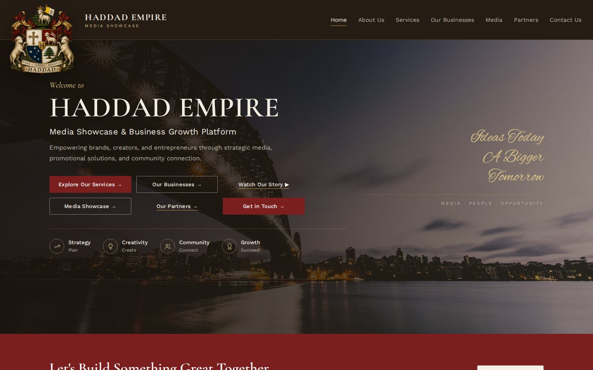
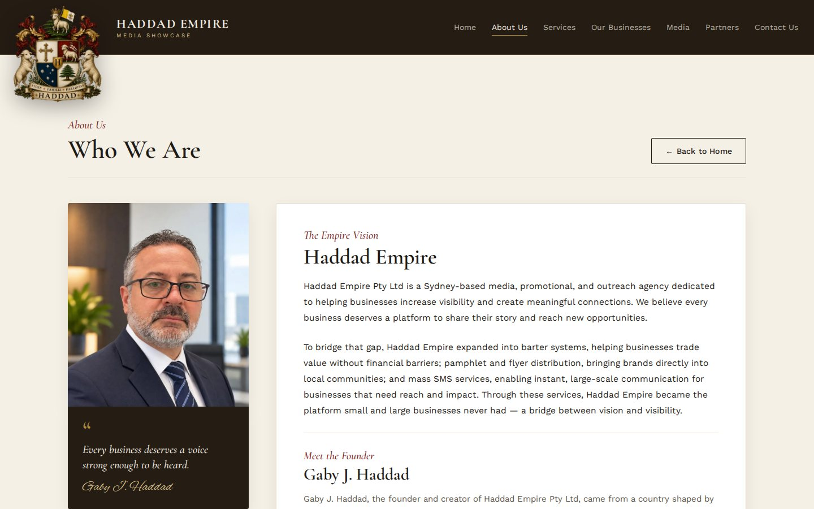
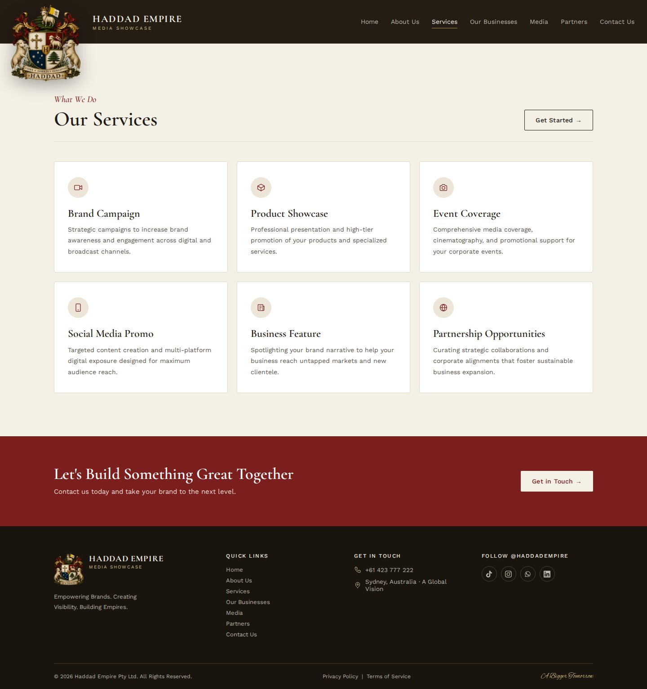
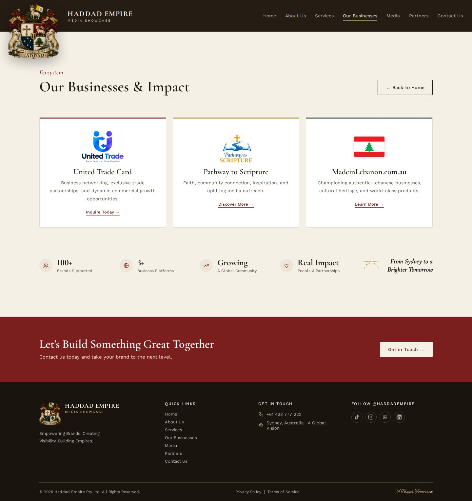
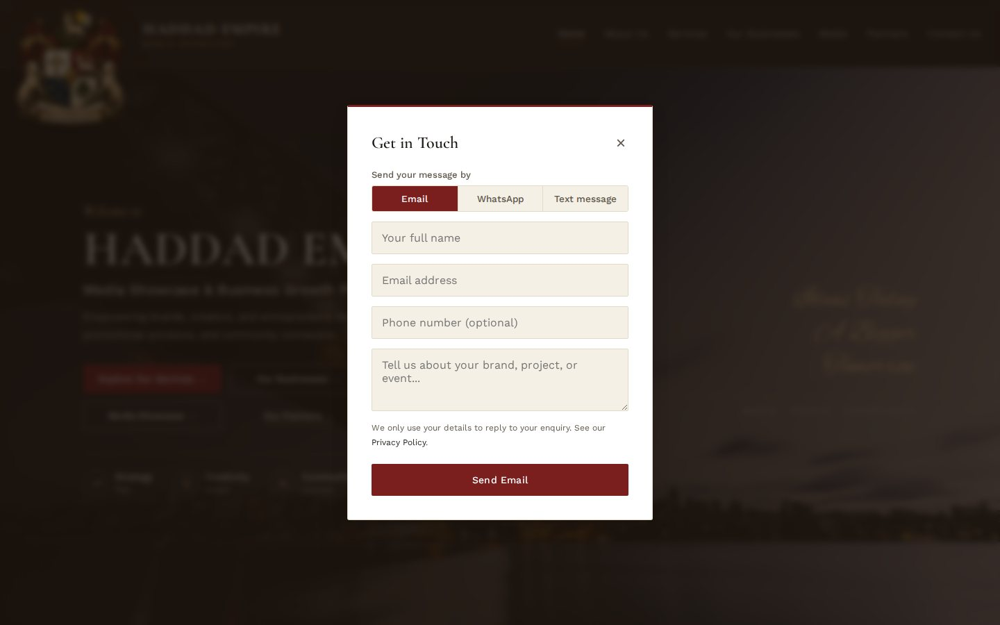
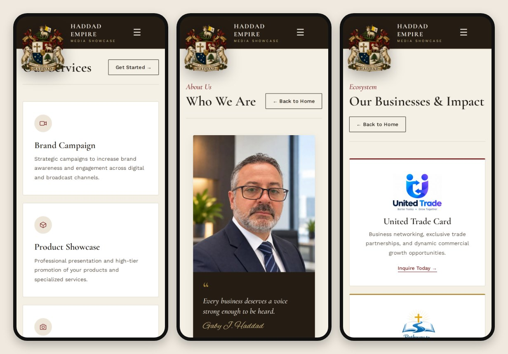

# 🏛️ Haddad Empire: Website Showcase

**A website I designed, built and launched for Haddad Empire Pty Ltd, a media, promotional and outreach agency in Sydney.**

<a href="https://haddadempire.com"><picture></picture></a>
<a href="https://haddadempire.com.au"><picture></picture></a>
<picture></picture>
<picture></picture>

<picture></picture>
<picture></picture>
<picture></picture>
<picture></picture>

---

## 📌 About the project

Haddad Empire is a Sydney-based agency founded by **Gaby J. Haddad**. It offers brand campaigns, product showcases, media production, flyer distribution, mass SMS and barter trade networking. The client wanted a premium, heritage-style online presence. The site needed to:

- tell the founder's story and present the company's family crest and identity
- present its services clearly to small and large businesses
- showcase the businesses in its ecosystem
- make it easy for visitors to get in touch by form, email, WhatsApp or SMS

I was responsible for the whole build: **design, development, content structure, SEO, security hardening, deployment and domain setup**. I also worked through several rounds of client feedback.

---

## ✨ Features

| Area | What I built |
|---|---|
| 🎨 **Brand & design** | A custom heritage look in deep burgundy, gold and parchment, with elegant serif typography and the family crest as the centrepiece |
| 👤 **Founder story** | An "About Us" page with the founder's portrait, his quote and the company's background |
| 🧰 **Services** | Service cards for brand campaigns, product showcases, media and photography, distribution and SMS outreach |
| 🤝 **Business ecosystem** | A showcase of the client's ventures: **United Trade Card**, **Pathway to Scripture** and **MadeinLebanon.com.au** |
| ✉️ **Contact** | A contact form with validation, plus one-tap **Email / WhatsApp / SMS** options |
| 📱 **Responsive** | Mobile-first layouts with a slide-out menu, tested on phones, tablets and desktop |
| 🪪 **Digital business cards** | Private staff business-card pages with a **vCard "Save Contact"** download and **QR codes** for printed cards |
| 🔍 **SEO** | Meta and Open Graph tags, a canonical URL, `sitemap.xml`, `robots.txt` and Google Search Console setup |
| 🛡️ **Security** | Security headers (CSP, HSTS, X-Frame-Options, Referrer-Policy), private internal tools blocked from public access |
| 🌐 **Domains** | `haddadempire.com` as the main domain, with `.com.au` redirecting to it (301) |
| ⚖️ **Legal** | Privacy Policy and Terms pages |

---

## 🖼️ Screenshots

### Home

### About Us: founder story

### Services

### Our Businesses & Impact

### Contact form

### Mobile

> The staff business-card pages are left out of the screenshots on purpose because they show personal contact details.

---

## 🛠️ Tech stack

- **Frontend:** semantic HTML5, modern CSS (custom properties, Flexbox and Grid, animations), vanilla JavaScript
- **Hosting & deployment:** Netlify, with continuous deployment from a private GitHub repository
- **Forms:** a third-party form-to-email service with spam protection
- **SEO & analytics:** Google Search Console, sitemap, structured meta tags
- **Security:** Netlify headers and redirect rules, branch protection on the production branch

---

## 🧭 My process

1. **Discovery:** gathered the client's brand assets, founder story and list of services.
2. **Design:** created a premium heritage look built around the family crest.
3. **Build:** produced a lightweight static site with no framework overhead, so pages load fast.
4. **Iteration:** worked through several rounds of client feedback on content, layout and imagery.
5. **Launch:** connected the domains, set up redirects and security headers, and submitted the site to Google.
6. **Maintenance:** continue to make ongoing updates and add new features, such as the staff digital business cards.

---

## 🔒 Why there's no source code here

> [!IMPORTANT]
> **This is a showcase repository. It contains only screenshots and this write-up.**
>
> Haddad Empire is a **real client project**. The client owns the source code, and it is kept in a **private repository** because it contains:
> - the client's business content, branding assets and data
> - configuration and integration keys used by the live site (form handling, deployment)
> - personal details of the client's staff, used for their digital business cards
>
> Making that repository public would expose the client's data, so I keep it private. This repo explains what I built and how. The finished site is live at **[haddadempire.com](https://haddadempire.com)**.

---

## 👨‍💻 Author

**Jamshaid Khan Niazi**, web developer

- 🌐 Portfolio: [jamshaidkhanniazi5965-ship-it.github.io](https://jamshaidkhanniazi5965-ship-it.github.io)
- 💼 GitHub: [@jamshaidkhanniazi5965-ship-it](https://github.com/jamshaidkhanniazi5965-ship-it)

---

© Haddad Empire Pty Ltd. The brand, logo, crest, photos and content belong to the client and are shown here with permission for portfolio purposes only. The source code is not included.

